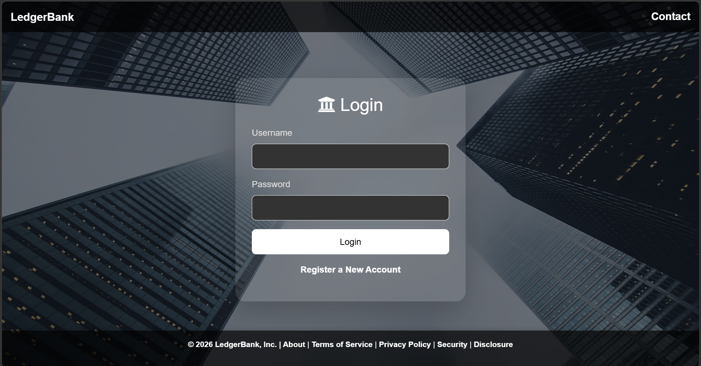
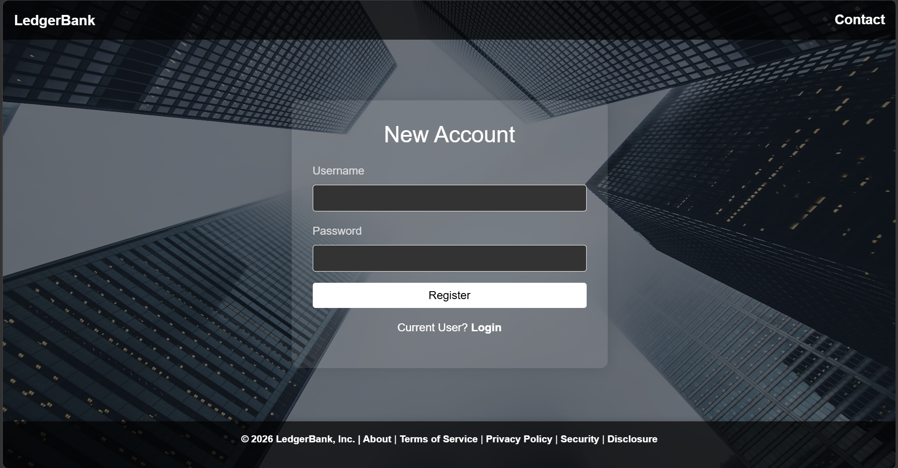
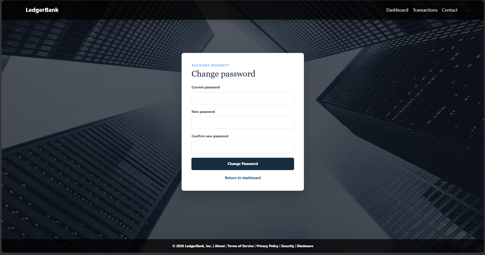
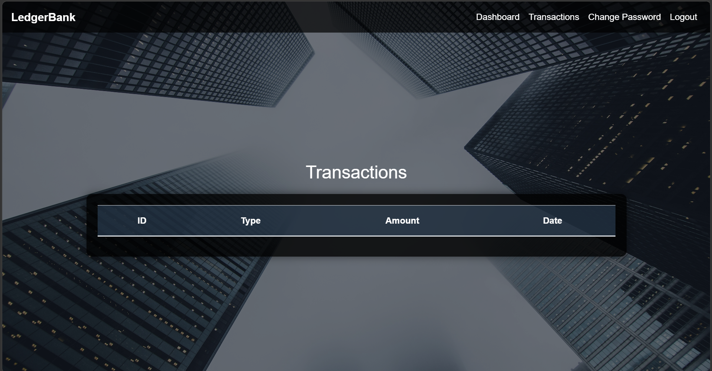
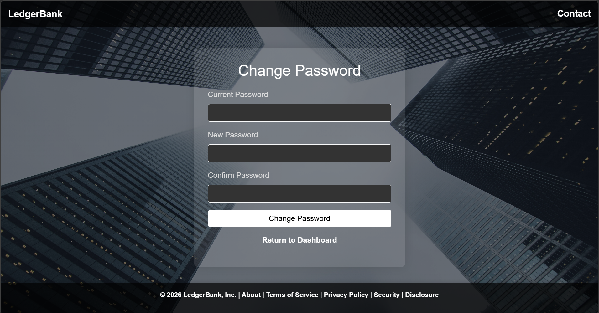

# LedgerBank

A bank application built with Java, Spring Boot, and MySQL that simulates real world financial operations such as account management, deposits, withdrawals, transfers, and transaction tracking.

## Features
- User registration and login
- Secure account access using Spring Security
- Balance tracking for checking and savings accounts
- Deposit and withdrawal operations
- Transfers between account types and between users
- Transaction history viewing
- Authenticated password changes

## Tech Stack
- Java 25
- Spring Boot 3
- Spring Security
- Spring Data JPA
- Thymeleaf
- MySQL
- Maven
- Bootstrap

## How It Works
The application follows a simple banking workflow: a user creates an account and logs in with secure credentials, the system validates the session and grants access to the dashboard, and the user can then view balances, deposit funds, withdraw money, or transfer funds between accounts. Every action is recorded as a transaction in the database, and the dashboard presents the current balances and recent activity so the user has a clear view of their financial status. This is implemented using Spring Boot for the backend, Spring Security for authentication, JPA for database access, and Thymeleaf for the web interface.

## Getting Started
### Prerequisites
- Java 25+
- Maven
- MySQL

### Installation
1. Clone the repository:
   ```bash
   git clone https://github.com/mohamedaradaib/LedgerBank.git
   cd LedgerBank
   ```

2. By default, the app uses an in-memory H2 database for local development. To use local MySQL, create the database and tables:
   ```sql
   CREATE DATABASE bankdb;
   ```
   Then, from the project root, run `mysql -u root -p bankdb < src/main/resources/static/mysql/SQLScript.txt`.

3. Set `DB_USERNAME` and `DB_PASSWORD` in your environment. Optionally set `DB_URL` if MySQL is not at `localhost:3306/bankdb`.

### Run the application:
1. Run command in terminal:
   ```
   ./mvnw spring-boot:run
   ```

   To run with MySQL, activate the `mysql` profile: `SPRING_PROFILES_ACTIVE=mysql ./mvnw spring-boot:run`.

2. Open the Springboot localhost URL:
   ```
   http://localhost:8080
   ```

## Live Demo
[ledgerbank-production.up.railway.app](https://ledgerbank-production.up.railway.app/)

## Screenshots










## License
[LICENSE](./LICENSE)
